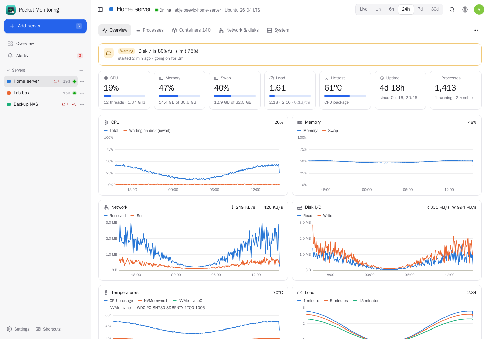
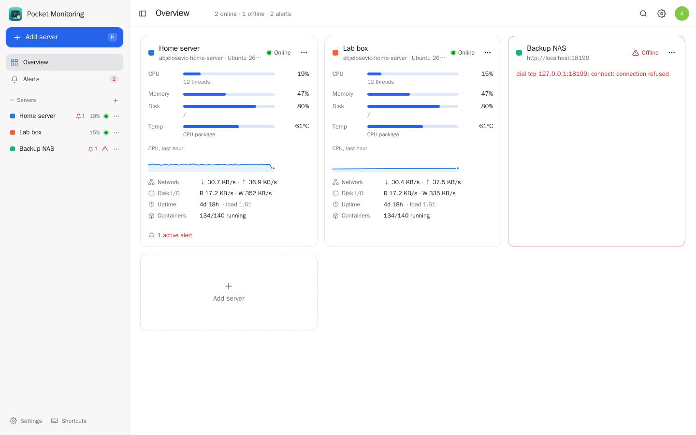
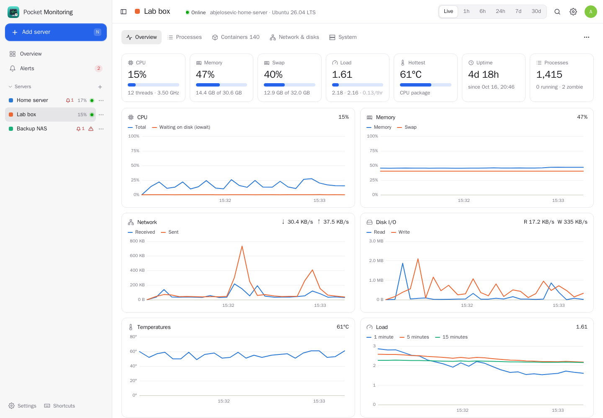
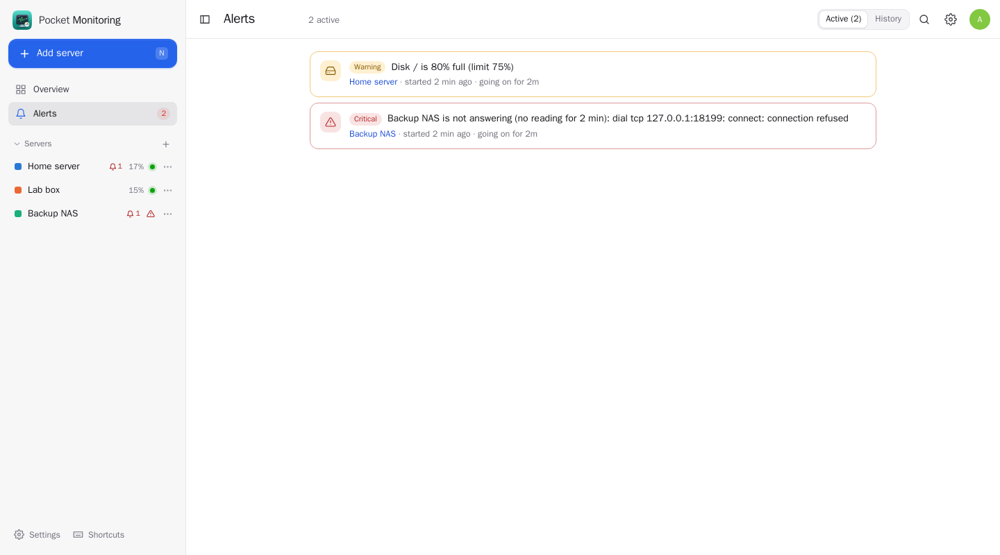
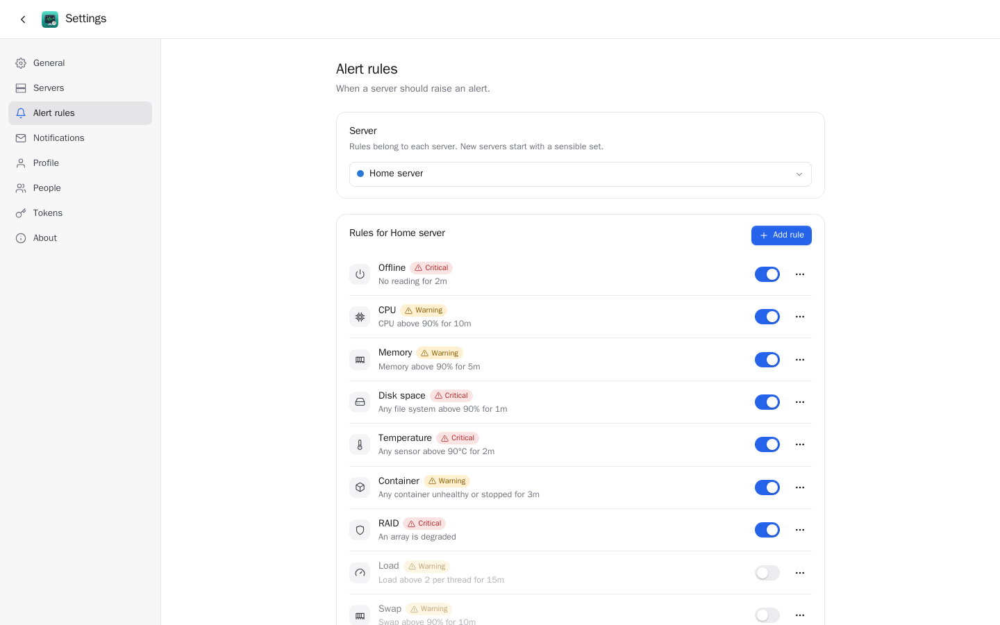
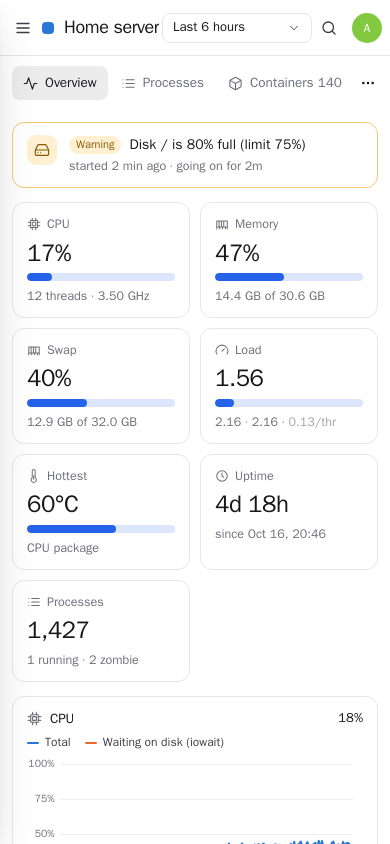

<p align="center"></p>
<h1 align="center">Pocket Monitoring</h1>
<p align="center">Watch your server and every other machine you own: CPU, memory, swap, load, network, disks, file systems, temperatures, processes and containers — live, as history, and with alerts on your phone when something runs hot, fills up, crashes or goes offline.<br>One Go binary, one SQLite file, one volume.</p>

Pocket Monitoring is Glances with a memory and a household. It reads the box it runs on straight from
`/proc`, `/sys` and the Docker socket, keeps a minute-by-minute history for a week and quarter-hour
averages for a year, and pulls in your other machines through a tiny agent (the same binary) or any
Glances server you already have. Everyone on the box has their own servers and alert rules; share a
server with someone and they see it read-only.

<p align="center"></p>

<table>
  <tr>
    <td width="50%"></td>
    <td width="50%"></td>
  </tr>
  <tr>
    <td align="center"><sub>Every server at a glance: CPU, memory, fullest disk, hottest sensor.</sub></td>
    <td align="center"><sub>Live: the last 15 minutes, a reading every 5 seconds.</sub></td>
  </tr>
  <tr>
    <td width="50%"></td>
    <td width="50%"></td>
  </tr>
  <tr>
    <td align="center"><sub>Alerts open when a rule holds long enough and close on their own.</sub></td>
    <td align="center"><sub>Rules per server: limits, how long, warning or critical.</sub></td>
  </tr>
</table>

<p align="center"></p>

Screenshots: this box with a day of demo history (`DEMO_DATA=true`), an agent and an unreachable one.

## What it shows

- **Quick look:** CPU, memory, swap, load (and per thread), the hottest sensor, uptime, processes.
- **History** for live / 1 h / 6 h / 24 h / 7 d / 30 d / 90 d: CPU and I/O wait, memory and swap, network
  in/out, disk read/write, every temperature sensor, load 1/5/15.
- **CPU:** user, system, I/O wait, steal, idle, every core, frequency, context switches and interrupts.
- **Memory:** used by apps, buffers, cache, free, shared; swap with paging rates.
- **Network:** every interface with rates, totals, errors, link speed and addresses (bridges hidden by default).
- **Disks:** per-device throughput, IOPS and busy time; every file system with free space and inodes,
  NFS/SMB included (a hung mount can't stall a reading); Linux software RAID.
- **Sensors:** CPU package and cores, each NVMe drive by name, chipset, Wi-Fi card, fans.
- **Processes:** the busiest and the biggest, with user, threads, state, disk I/O and the container they run in.
- **Containers:** state and health, CPU, memory against the limit, network and block I/O, uptime, restarts,
  compose project and ports.
- **Container logs:** any container's log, or every running container merged by time; follow new lines
  live, filter, errors only, times, wrap, the last 200–5,000 lines, download. Logs are for the server's
  owner only (they tend to hold secrets); agents serve them too, Glances doesn't.

## Alerts

Each server comes with sensible rules: offline for 2 minutes, CPU over 90 % for 10 minutes, memory over
90 %, any disk over 90 %, any sensor over 90 °C, an unhealthy or crashed container, a degraded RAID
array. Change the limits, add rules for one mount, sensor or container, or switch them off. An alert
fires when its condition has held for the rule's duration, clears with a little hysteresis so it
doesn't flap, and both ends are sent through **Apprise**, **ntfy** or a **webhook** to the owner and to
everyone the server is shared with. A container that you stop on purpose (exit 0, 137, 143) is not a crash.

## More machines

Run the agent on any Linux machine and add it under *Settings → Servers*:

```sh
docker run -d --name pocket-monitoring-agent --restart unless-stopped \
  --user 0:0 --pid host --network host \
  -v /:/host/root:ro,rslave -v /var/run/docker.sock:/var/run/docker.sock:ro \
  -e AGENT_TOKEN=$(openssl rand -hex 24) -e AGENT_PORT=8193 \
  ghcr.io/abjelosevic88/pocket-homelab-monitoring:latest agent
```

or the binary itself: `AGENT_TOKEN=… pocket-monitoring agent`. It serves one authenticated endpoint
and keeps nothing on disk. A machine that already runs **Glances 4** (`glances -w`) can be added directly
by its address — no agent needed.

## Run it

```yaml
services:
  pocket-monitoring:
    image: ghcr.io/abjelosevic88/pocket-homelab-monitoring:latest
    container_name: pocket-monitoring
    restart: unless-stopped
    pid: host            # see every process on the box
    network_mode: host   # see the real network interfaces
    group_add: ["988"]   # the docker group's id on your host: getent group docker
    environment:
      PORT: "8080"
      TZ: Europe/Berlin
      BASE_URL: https://monitoring.example.com
    volumes:
      - ./data:/data
      - /:/host/root:ro,rslave                          # file systems and /etc/os-release
      - /var/run/docker.sock:/var/run/docker.sock:ro    # containers
```

Open it, create the first account, and *This server* is already there. Everything else is in
[docs/configuration.md](docs/configuration.md); the HTTP API is in [docs/api.md](docs/api.md).

**Pocket Core.** With `CORE_URL` set it registers as `monitoring`, people sign in with Pocket Core,
paired phones' tokens work, alerts are published as `monitoring.alert` / `monitoring.resolved`, and
other Pocket apps can be linked to read your servers' status (`monitoring:read`).

## Build

```sh
make            # web UI + binary
make run        # no login, demo history
make test
make docker
```

## License

MIT
